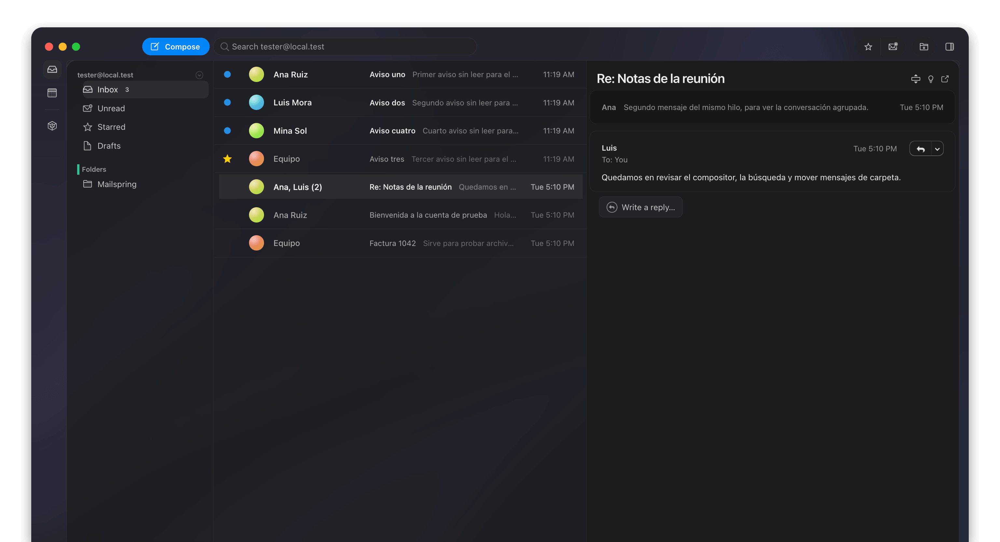

# MailAr

MailAr is a fork of [Mailspring](https://github.com/foundry376/mailspring). Mailspring is already an excellent open-source mail client: a fast Electron and React app with a local C++ sync engine. This fork keeps that foundation and adds the pieces that were missing for day-to-day use on macOS: a menu-bar inbox, a calmer interface, and a shorter set of controls.

The sync engine still runs on your computer. Mail does not pass through a MailAr server.



## What changed

- macOS menu-bar tray with unread mail counter. Displays last unread mails from the last 31 days using avatars, time, subject & sender. Also you have existsing buttons like Open Inbox, New Message and Preferences, and Quit stay at the bottom.. The panel uses the macOS menu material (blur and translucency) and the system font.
- The UI the Apple system more closely. The window is translucent, rounded corners, and accent color changed. The contact avatars are  gradient circles.


### Removed

A few controls that are not part of everyday mail were taken out:

- Print the current thread
- View the message source
- Log data and copy debug info from the message menu

Receiving, reading, searching, composing, replying, folders, the calendar, and preferences stay.

## Run from source

From the repository root:

```bash
npm install
npm start
```

On Apple Silicon, use a native arm64 terminal. `npm install` downloads an arm64 Electron and compiles native modules such as `better-sqlite3` for that architecture. Setting `npm_config_arch=x64` downloads an Intel Electron while those modules stay arm64, and the app then fails to load its database.

Extra arguments go after `--`:

```bash
npm start -- --help
```

To build a packaged app:

```bash
npm run build
```

## License

MailAr is free software, released under the [GNU General Public License v3.0](LICENSE.md), the same license as Mailspring. You can use, modify, and share it under those terms. The [sync engine](https://github.com/Foundry376/Mailspring-Sync) is also GPL-3.0.
