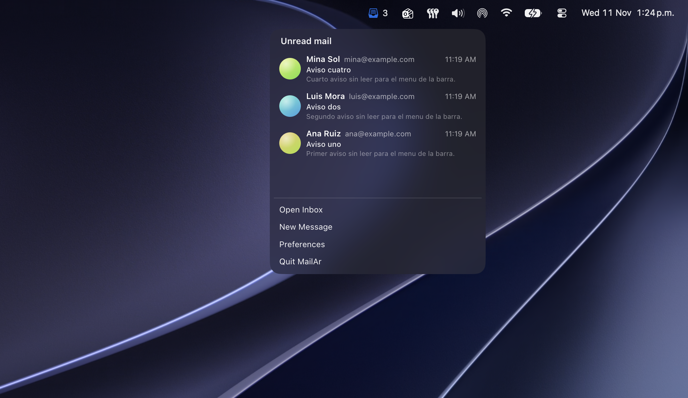
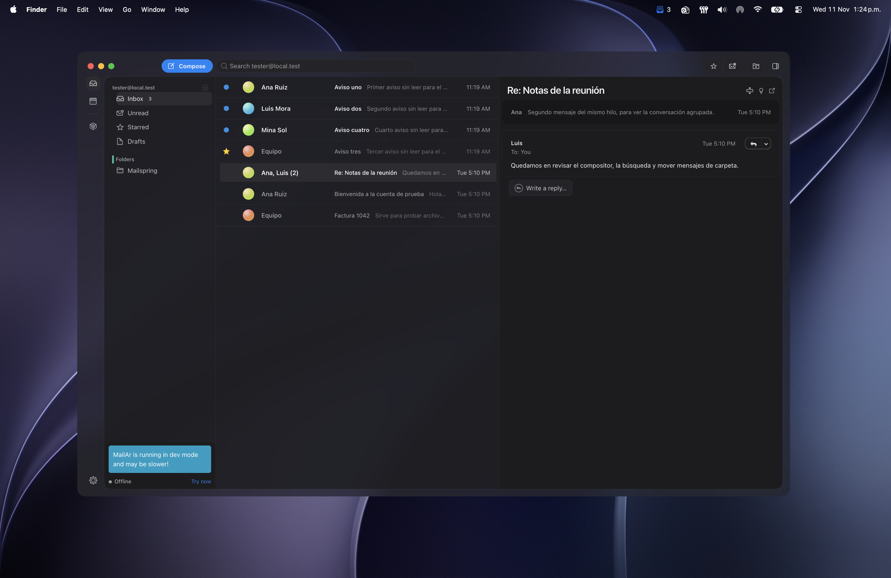

# MailAr

MailAr is a fork of [Mailspring](https://github.com/foundry376/mailspring). Mailspring is already an excellent open-source mail client: a fast Electron and React app with a local C++ sync engine. This fork keeps that foundation and adds the pieces that were missing for day-to-day use on macOS: a menu-bar inbox, a calmer interface, and a shorter set of controls.

The sync engine still runs on your computer. Mail does not pass through a MailAr server.

## What changed

### macOS menu-bar tray

The status item opens a small panel of unread mail from the last 31 days.

- A title, then each message on its own block: sender name and email on one line, subject, and one line of the body. Long lines truncate with `...`.
- The time uses the same short format as the inbox (`11:19 AM`, `Tue 5:10 PM`), not a full timestamp.
- Avatars are soft gradient circles.
- Choosing a row opens the app on that thread.
- The icon shows an unread count.
- Open Inbox, New Message, Preferences, and Quit stay at the bottom.
- The panel uses the macOS menu material (blur and translucency) and the system font.

Windows and Linux keep Mailspring’s original status-item menu.



### macOS interface

On Apple, the interface follows the system more closely.

- The UI, including message text, uses the system font. Windows and Linux keep the original typeface.
- The window is translucent, with a rounded card, a pill Compose button, and the accent color `#0485f7`.
- The three-column layout is folders, the message list, and the open message. The reading column is opaque so the subject and controls stay clear.
- Hovering a row no longer lays a translucent veil over the subject.
- Avatars in the list, contacts, and the tray are gradient circles without initials.
- Rich-text buttons in the composer (bold, italic, lists, link, and the rest) render again.



### Removed

A few controls that are not part of everyday mail were taken out:

- Print the current thread
- View the message source
- Log data and copy debug info from the message menu

Receiving, reading, searching, composing, replying, folders, the calendar, and preferences stay.

## Run from source

From the repository root:

```bash
npm install
npm start
```

On Apple Silicon, use a native arm64 terminal. `npm install` downloads an arm64 Electron and compiles native modules such as `better-sqlite3` for that architecture. Setting `npm_config_arch=x64` downloads an Intel Electron while those modules stay arm64, and the app then fails to load its database.

Extra arguments go after `--`:

```bash
npm start -- --help
```

To build a packaged app:

```bash
npm run build
```

## License

MailAr is free software, released under the [GNU General Public License v3.0](LICENSE.md), the same license as Mailspring. You can use, modify, and share it under those terms. The [sync engine](https://github.com/Foundry376/Mailspring-Sync) is also GPL-3.0.
